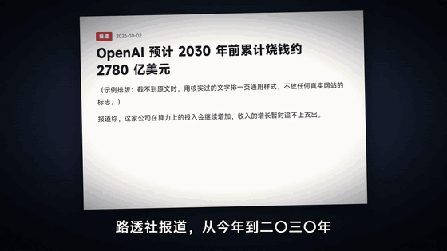
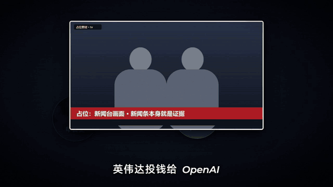

# wallstreet-explainer

有一类财经视频，画面高级、简约，又有质感。这种风格怎么做呢？我做了一个 Skill，可以直接生成这种视频。


这个就是用这个 Skill 打磨出来的样片《AI 到底有多烧钱》，77 秒，这里压成了没有声音的 GIF。片子里的实拍、人物和新闻截图都是引用的，出处在 [CREDITS.md](examples/ai-burn-money/CREDITS.md)。

## 两种模式

- **有真人口播视频**（真人或数字人，一个机位）：走真人口播模式。她是片子的地面，证据挂到她身后的墙上，关键词身后换成织物舞台和巨字，讲证据时她缩进角上圆窗或竖窗，讲完再长回全屏。口播直接当配音，逐字对齐出时间线。例子：`examples/gold-rates/`（《打仗了，黄金为什么反而跌》，28 秒）。
- **没有真人视频**：走无人动效包装模式，当事人实拍抠像站在大字前面，配音用合成语音。

## 先说画面

这类财经视频，画面全是真实素材：新闻发布会、产品发布、企业官方画面，然后把数字和关系用可视化的方式表达出来。

所以最核心的就两件事：素材和数字表达。

素材的选择非常重要。这个 Skill 里面明确规定了素材的优先级，它会自己去各大主流视频网站上找到合适的片段，裁剪、处理。片子里的人也是真人，从发布会、采访里一帧一帧抠出来，站在大字前面讲。

数字表达就是 B-roll 的重点。数据怎么放、关系怎么画、图表怎么呈现，这些控制了整个片子的风格。


上面是样片里四个镜头动作，从上往下：镜头沿着桌上的新闻滑过去；黄仁勋从发布会画面里抠出来，身后换成"5.2 万亿"；整组横推出去换成 Altman；新闻原文倒下去变成桌面，图表立起来。

## 镜头和转场

然后是镜头之间的连贯性和转场。

这种财经视频最重要的是克制。同一个对象可以挂镜头运动，不是每出现一个新东西就切一下。不要为了有变化就去换机位、换背景，也不要连续硬切好几次让观众重新找位置。所有 PPT 式的渐入渐出，全部排除。

背景的质感、字体、节奏，也都是风格的一部分。

整个片子是用代码一帧一帧画出来的，通过时间线编排，最后渲染成视频。配乐用平稳的底乐，人声出来的时候自动压低，再加一些经典的财经类音效。

## 这套风格是怎么来的

这套风格是参考这类财经视频提取出来的：一个问题就能撑起全篇，开头五到七秒抛出反差，结尾回答它，形成一句判断。

图形有自己的表达任务，实拍以直接切为主，新闻和报告给出具体截图，用高亮标出来。

色调、字体、节奏，都是复刻出来的。

## 每一镜都要回答

这个 Skill 在设计的时候，每一镜都要回答：内容有没有增量？镜头有没有承接？素材是不是真实、高清、官方的？数字有没有表达清楚？

交付前静音看一遍，画面本身就能讲清楚在说什么。

小字不要太多，太多就 AI 味了。

## 两档做法

这一版加了一个模板档。现在有两种做法，可以混着用：

- **模板档**：一条片就是一张镜头表。每一镜先写清楚这一镜要让观众多懂什么，再从 33 个场景里挑一个意思对得上的：一个大数、一笔账、几个数比高低、新闻原文、人物关系……把字、数、图填进去就行。镜头怎么走、东西怎么出现、前后层、字号颜色，都由模板管。写完先跑 `node scripts/render.mjs --dir <片子> --check`，它用文字指出哪一镜有问题，不用渲染就能改。
- **手写档**：原来的做法，强模型一镜一镜自己写。模板对不上的那一镜，也可以单独手写。

做模板档，是想让弱一些的模型也能稳定出片。这一点还没实测过。

下面是模板示例片里的三个场景。画面里的照片和新闻都是占位图，正式做片要换成真实素材。






场景的静帧总览在 `kit/gallery/00_sheet.jpg`。每个场景什么时候用、什么时候别用，见 `kit/README.md` 和 `references/rules.md`。

## 怎么用

用法很简单：把这个 Skill 的链接发给你的 AI 工具，让它下载、导入，然后直接生成视频就行了。

用 Claude Code 的话，自己装也就几行：

```bash
git clone https://github.com/HeyChengC/wallstreet-explainer.git ~/.claude/skills/wallstreet-explainer
cd ~/.claude/skills/wallstreet-explainer
pip install -r requirements.txt
npm install && npx playwright install chromium
```

再装一个 ffmpeg，放进 PATH。装完重启 Claude Code，跟它说"用 wallstreet-explainer 做一条 1 分钟的片子，讲 AI 到底有多烧钱"就行。

选题可以自己选，文案可以自己给，也可以让它来出。开头会让你选一个钩子，财经风格的钩子很重要，你可以自己描述想要什么，也可以让 AI 给你准备几个，自己挑。

配音一开始用免费的 edge-tts 临时配，先把时间线排出来。文案和画面都定了，再换成你自己的配音：每句存成 `voice/<句子id>.final.wav`，跑一下 `python scripts/temp_voice.py film/script.json --asr`，画面会跟着重新对齐。

几个可能会碰到的问题：

- yt-dlp 和 edge-tts 隔一阵会被 403，`pip install -U` 一下就好。
- 抠人要装 `onnxruntime-gpu`（有 N 卡）或者 `onnxruntime`，再用 rembg 把模型下下来：`python -c "from rembg import new_session; new_session('isnet-general-use')"`。
- 换配音以后逐字对齐要 faster-whisper，有 N 卡快很多。
- 字体不随仓库给，要自己下：字幕 MiSans，标签和片名阿里妈妈数黑体，大数字 Bebas Neue，英文小标 Montserrat，兜底 Noto Sans SC。下好放进 skill 里的 `fonts/` 文件夹（放在别处的话，在 `scripts/local.json` 里写 `"fonts_dir": "<字体文件夹>"`），文件名要和 `kit/kit.css` 里写的对上。字幕里的英文和数字用 Montserrat 斜体。
- Playwright 装在别的地方，设个环境变量 `PLAYWRIGHT_FROM` 指过去就行。

## 里面有什么

`SKILL.md` 是 AI 读的入口，具体的东西都在 `references/` 里：每一镜怎么想（`thinking.md`）、镜头怎么动才不像 PPT（`motion.md`）、画面和转场（`style.md`、`grammar.md`）、开头的钩子（`opening.md`）、找素材和声音（`sourcing.md`、`audio.md`）、交付前查什么、踩过哪些坑（`review.md`、`lessons.md`），还有模板档必须守的规则（`rules.md`）。

`scripts/` 里是做片要用的工具：

| 脚本 | 干什么 |
|---|---|
| `footage.py` | 搜片、下片（可以只下一段）、拼联系表、找切点、抽帧、看原声剪口 |
| `snap_news.mjs` | 截新闻原文，量出关键词的位置，用来画高亮 |
| `temp_voice.py` | 临时配音和时间线，换正式配音后重新对齐 |
| `matte.py`、`matte_clean.py` | 把视频里的人一帧一帧抠出来 |
| `matte_despill.py` | 去掉抠像边上原片背景的色边（比如蓝幕反光） |
| `stage25d.js` | 镜头、景深、运动模糊、大字这些小工具 |
| `film_base.js` | 底座：读时间线、按字取时刻、登记镜头、字幕，每条片都一样 |
| `moves.js` | 手法库：横推换人、人身后换背景、画框推满屏这些磨过的动作，只管怎么动，画面每条片自己写 |
| `render.mjs` | 一帧一帧渲染成视频；`--moves` 列出每一镜用了哪些手法；`--check` 查模板档的镜头表，不用渲染 |
| `new_film.mjs` | 新建一条片，底座和模板库都拷好；加 `--demo` 直接建出模板示例片 |
| `timeline_stub.mjs` | 还没配音时，按字数先估一条时间线，画面先挂上去 |
| `strip.py` | 把一个镜头动作拼成连续帧，看有没有穿帮 |
| `motion_check.py` | 量一下画面是不是太"死" |
| `mix.py` | 配音、原声、音效、配乐混在一起 |

`starter/` 是新片的起点：底座，加一张带 3 镜示例的镜头表。

`examples/ai-burn-money/` 是样片的文案、导演表、画面代码，还有每一段为什么这么拍。

`examples/google-apple-20b/` 是用手写档做的一条 28 秒短片《谷歌给苹果的两百亿》的文案和画面代码。素材有版权，没放进来。

`kit/` 是模板库：33 个场景、两条示例片、场景图库。

## 素材和版权

这类片子一定会用到别人的素材：企业宣传片、新闻画面、网页截图、当事人原声。只拿来做评论和解读，每条片都在简介里写清楚出处，写法可以参考 [CREDITS.md](examples/ai-burn-money/CREDITS.md)。有没有风险，你自己判断。

新闻网页截不到的时候，可以用核实过的文字自己排一张图，但别仿真实网站的 logo 和版式，也别编数据。别拿真实博主、电影、品牌的名字给自己的片子起名。

## License

代码和文档是 MIT，见 [LICENSE](LICENSE)。样片里的第三方画面、截图、logo 和人物不在 MIT 范围内，归各自的所有者。

## 联系

微信号 Yangdavee，备注来意。

## 友情链接

https://linux.do/
